# Emplake

Use os quatro dígitos da placa, na ordem, para montar uma igualdade verdadeira.

**Jogar agora: <https://emplake.web.app>**

Trabalho em grupo da disciplina **Desenvolvimento para Dispositivos Móveis**, da Universidade Federal de
São Carlos, com o Prof. José Guimarães. É uma engenharia reversa do
[Emplake](https://www.cyan-lang.org/emplake/), jogo concebido pelo Prof. Walter A. Carnielli.

**Equipe:** Bruna Scarpelli e Gustavo Sanches Martins Kis.

  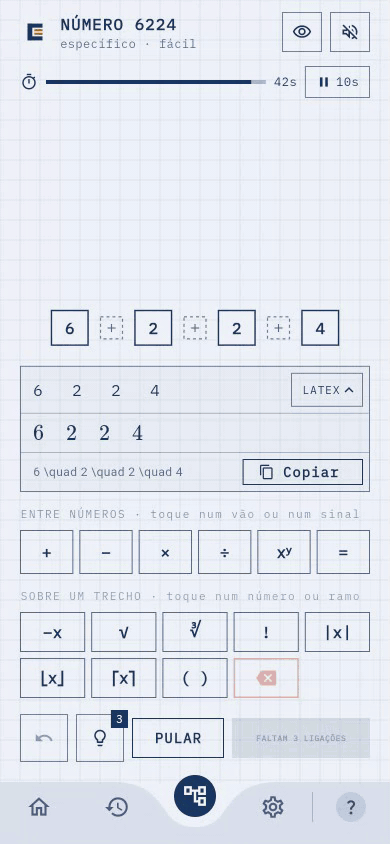

## Sumário

1. [Como se joga](#como-se-joga)
2. [Requisitos do enunciado](#requisitos-do-enunciado)
   - [Características do jogo](#características-do-jogo)
   - [Características do aplicativo](#características-do-aplicativo)
3. [O que vai além do pedido](#o-que-vai-além-do-pedido)
4. [Decisões de design](#decisões-de-design)
5. [Mais documentação](#mais-documentação)
6. [Créditos](#créditos)

## Como se joga

A expressão é montada como uma **árvore que cresce para cima**, a partir dos quatro dígitos:

- toque num **vão** entre dois blocos e escolha `+ − × ÷ xʸ` para ligá-los. A ordem das ligações define
  o agrupamento, então os parênteses saem da própria árvore;
- o `=` entra num vão, uma única vez, e separa os dois lados. Ele pode ser o primeiro sinal colocado;
- toque num **nó** (um número ou um ramo) para aplicar `−x √ ∛ ! |x| ⌊x⌋ ⌈x⌉`, trocar o operador, pôr
  `( )` ou removê-lo. Os sinais também podem ser arrastados de um vão para outro;
- cada nó mostra o valor calculado na hora, e a fórmula aparece em texto e em LaTeX.

| Nível | Operadores | Tempo |
|---|---|---|
| Fácil | + − × ÷ ( ) √ ∛ ! xʸ \|x\| ⌊x⌋ ⌈x⌉, e aceita divisão não inteira | 45 s |
| Intermediário | + − × ÷ ( ) √ ∛ ! xʸ \|x\| | 45 s |
| Avançado | + − × ÷ ( ) √ ! \|x\| | 60 s |
| Difícil | + − × ÷ ( ) \|x\| | 75 s |

No desktop, `Enter` verifica, `Esc` pula, `Tab` alterna a seleção, `Ctrl+Z` desfaz e `+ - * / ^ = ! ( )`
aplicam operadores.

## Requisitos do enunciado

Cada linha diz como o requisito foi atendido e onde ele está no código. Em "Tela", a captura abre ao
clicar, com o tema claro à esquerda e o escuro à direita.

### Características do jogo

| Requisito | Como foi feito | Código | Tela |
|---|---|---|---|
| Níveis Fácil, Intermediário, Avançado e Difícil, cada um com os seus operadores | O enum `Level` define os binários, os unários, o tempo e os pontos de cada nível. A paleta só mostra os operadores do nível, e o avaliador recusa os outros. | [level.dart](lib/features/game/domain/level.dart), [operator_palette.dart](lib/features/game/presentation/operator_palette.dart) | 

ver tela
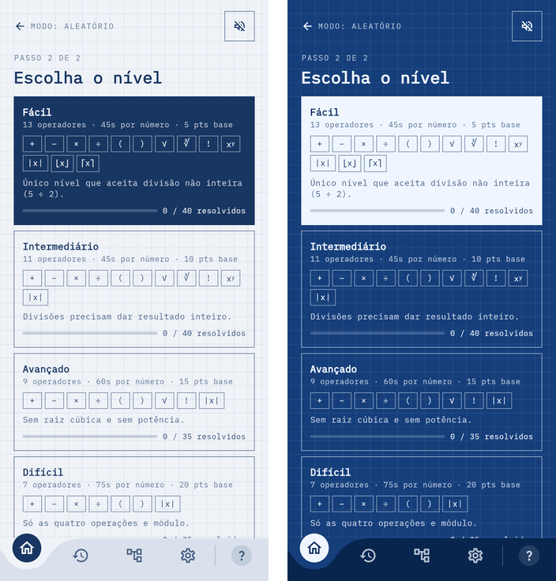
 |
| Base ⌊x⌋, teto ⌈x⌉ e módulo \|x\| | São unários do motor, calculados com frações exatas. Base e teto só existem no Fácil, e o módulo existe em todos os níveis. | [evaluator.dart](lib/features/game/domain/evaluator.dart), [expr.dart](lib/features/game/domain/expr.dart) | |
| Divisão com resultado não inteiro só no Fácil, com erro nos outros níveis | O avaliador trabalha com frações exatas. Fora do Fácil, uma divisão não inteira gera o erro `nonIntegerDivision`, que aparece no próprio nó, com a explicação. | [evaluator.dart](lib/features/game/domain/evaluator.dart) | |
| Renderizador de LaTeX logo abaixo da fórmula montada | A caixa da fórmula mostra a expressão em texto e, logo abaixo, a mesma expressão renderizada pelo `flutter_math_fork`, com o código LaTeX para copiar. O LaTeX abre no botão **LATEX** da caixa, e o app lembra a escolha. Veja [por que fica assim](#latex-no-botão-da-caixa-da-fórmula). | [formula_panel.dart](lib/features/game/presentation/formula_panel.dart), [format.dart](lib/features/game/domain/format.dart) | 

ver tela
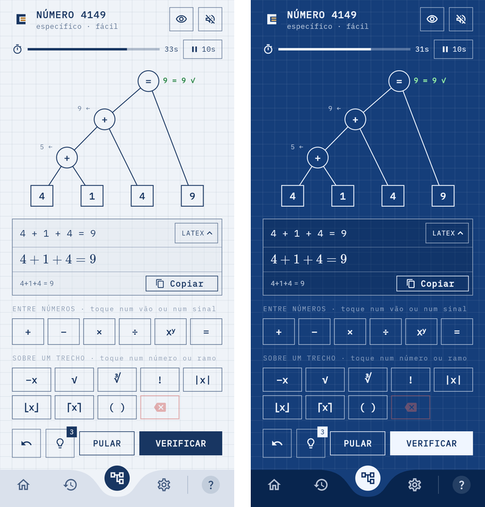
 |
| Interface da tela principal única | A expressão é uma árvore que cresce para cima a partir dos dígitos, com o valor de cada ramo ao lado. Veja [por que uma árvore](#a-expressão-como-árvore). | [tree_view.dart](lib/features/game/presentation/tree_view.dart), [board.dart](lib/features/game/domain/board.dart) | 

ver tela

 |
| O `=` pode ser colocado logo no início | O `=` entra em qualquer vão livre antes das ligações, e as ligações não podem atravessá-lo. | [board.dart](lib/features/game/domain/board.dart) | |

### Características do aplicativo

| Requisito | Como foi feito | Código | Tela |
|---|---|---|---|
| Som opcional | Os efeitos e a música começam **desligados**. O botão de som fica no topo de todas as telas, e a guia Jogo das configurações separa efeitos, música e vibração. | [settings_controller.dart](lib/features/settings/settings_controller.dart), [sound_service.dart](lib/core/audio/sound_service.dart) | 

ver tela
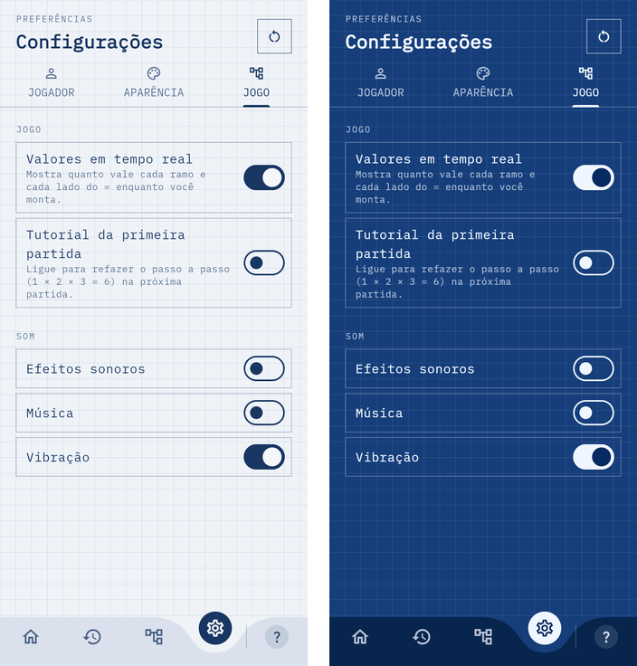
 |
| Uso pela web | Publicado no Firebase Hosting em <https://emplake.web.app>. | [firebase.json](firebase.json) | 

ver tela
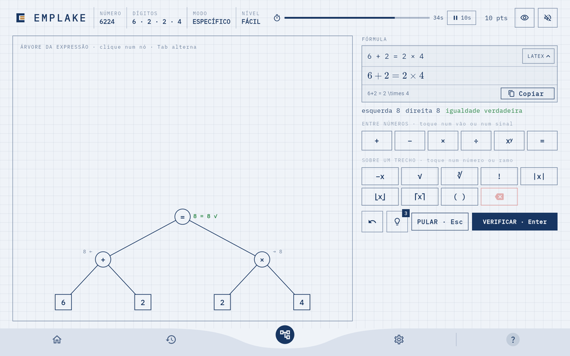
 |
| Login com `firebase_ui_auth`, por e-mail e senha ou pela Google, no plano Spark | A tela de login usa o `SignInScreen` do `firebase_ui_auth` com e-mail e senha. A Google passa pelo fluxo do próprio pacote (`AuthFlowBuilder<OAuthController>` com `GoogleProvider`), com um botão desenhado no estilo do app. Veja [por que o login não é a primeira tela](#o-login-não-é-a-primeira-tela). | [login_page.dart](lib/features/auth/login_page.dart) | 

ver tela
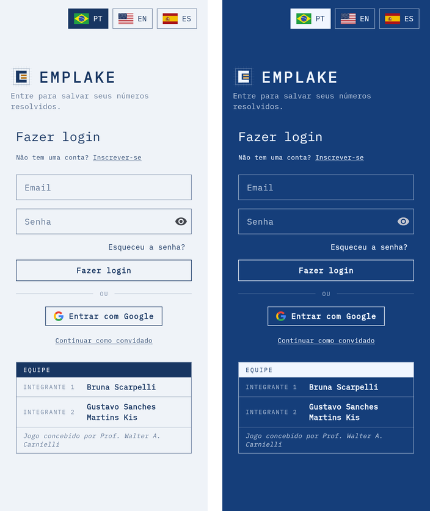
 |
| Nomes dos integrantes na página de login | O cartão **Equipe**, abaixo do formulário. | [login_page.dart](lib/features/auth/login_page.dart) | 

ver tela

 |
| Escolha do idioma na página de login, com bandeiras | Botões PT, EN e ES com bandeiras do pacote `country_flags`, no topo da tela de login. | [login_page.dart](lib/features/auth/login_page.dart), [bp_widgets.dart](lib/core/widgets/bp_widgets.dart) | 

ver tela
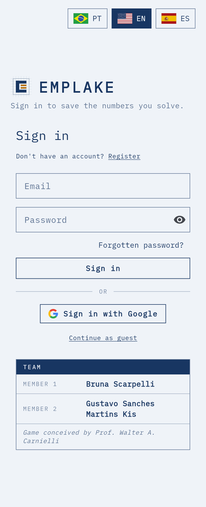
 |
| Todos os textos traduzidos com `flutter_localizations` | Os mais de 400 textos do app estão em português, inglês e espanhol, em arquivos ARB gerados pelo `flutter gen-l10n`. As telas do `firebase_ui_auth` usam o `firebase_ui_localizations`. | [lib/l10n/](lib/l10n/), [l10n.yaml](l10n.yaml), [gen_arb.py](tool/gen_arb.py) | 

ver tela

 |
| Navigation bar inferior com `curved_navigation_bar`, em todas as páginas depois do login, com ícone de configurações | A barra fica numa `StatefulShellRoute` do go_router, então acompanha todas as páginas. Ela tem Início, Resolvidos, Jogo e Configurações, e a Ajuda separada por um traço. | [app_shell.dart](lib/features/shell/app_shell.dart), [router.dart](lib/core/router.dart) | 

ver tela
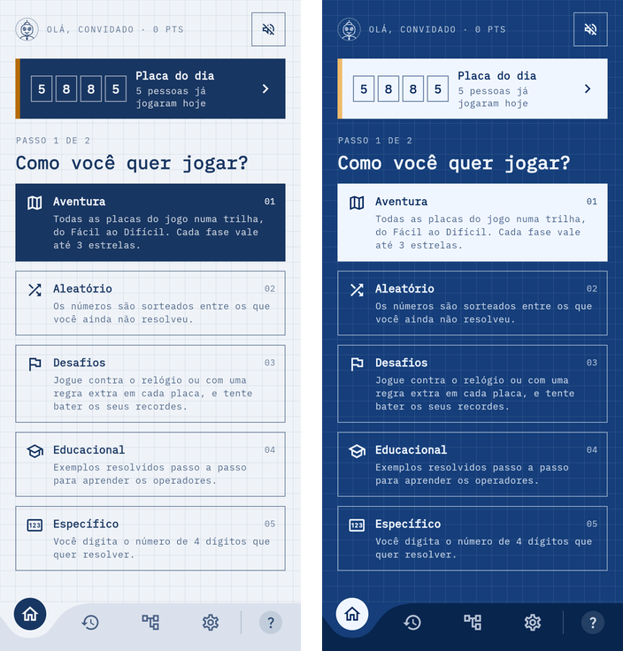
 |
| Configurações de tema claro ou escuro, tamanho da fonte, tipo da fonte e cor semente | Na guia Aparência: Sistema, Claro ou Escuro; seis cores prontas e um seletor livre para a cor semente; cinco fontes; tamanho de 80% a 140%. Todo o tema é derivado da cor semente. | [settings_page.dart](lib/features/settings/settings_page.dart), [seed_color_dialog.dart](lib/features/settings/seed_color_dialog.dart), [app_theme.dart](lib/core/theme/app_theme.dart) | 

ver tela
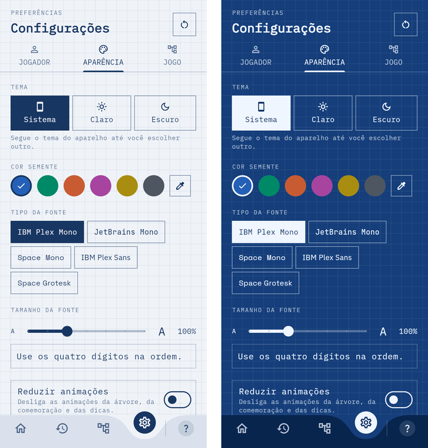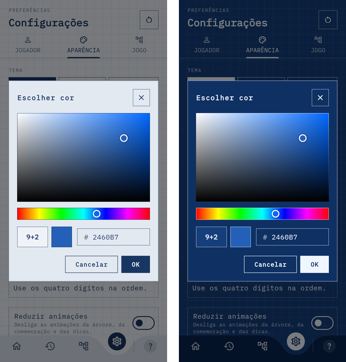
 |
| Tema padrão do dispositivo no início | O tema começa em **Sistema** e segue o modo claro ou escuro do aparelho até o jogador escolher outro. | [settings_controller.dart](lib/features/settings/settings_controller.dart) | 

ver tela
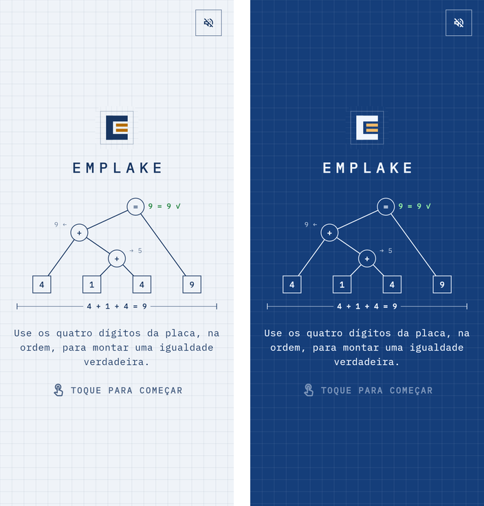
 |
| Voltar à mesma página ao reabrir, com `SharedPreferences` | O router grava a última página visitada e a reabre na inicialização. A partida em andamento também é gravada e volta pausada, com a árvore, o relógio e as dicas como estavam. | [router.dart](lib/core/router.dart), [prefs.dart](lib/core/prefs.dart), [game_controller.dart](lib/features/game/application/game_controller.dart) | |
| `flutter_riverpod` para gerenciar o estado | O `GameController` (um `Notifier`) guarda a partida inteira: árvore, seleção, histórico para desfazer, relógio, dicas e pausa. Outros providers cuidam das configurações, do perfil, do catálogo, da Aventura e dos Desafios. | [game_controller.dart](lib/features/game/application/game_controller.dart), [settings_controller.dart](lib/features/settings/settings_controller.dart), [firestore_repository.dart](lib/data/firestore_repository.dart) | |
| `go_router` para as rotas | Rotas declarativas com `StatefulShellRoute.indexedStack`, que mantém o estado de cada aba, e redirecionamento para o login quando não há usuário. | [router.dart](lib/core/router.dart) | |
| Uma animação | Ao verificar, os operadores saem da árvore e voam de volta aos seus botões na paleta. A árvore também anima cada ligação, a folha de resultado sobe da base da tela e a capa tem uma árvore animada. | [fly_back_overlay.dart](lib/features/game/presentation/fly_back_overlay.dart), [tree_view.dart](lib/features/game/presentation/tree_view.dart) | 

ver animação

 |
| Ler e escrever no Firestore com `FutureBuilder` e um indicador de progresso diferente do padrão | O repositório lê e grava perfil, resolvidos, pulados e a placa do dia. Os `FutureBuilder` ficam no sorteio do número, no histórico de resolvidos e no cumprimento da tela inicial. O indicador é o `hexagonDots` do pacote `loading_animation_widget`. | [firestore_repository.dart](lib/data/firestore_repository.dart), [new_game_page.dart](lib/features/game/presentation/new_game_page.dart), [solved_page.dart](lib/features/history/solved_page.dart), [bp_widgets.dart](lib/core/widgets/bp_widgets.dart) | 

ver tela
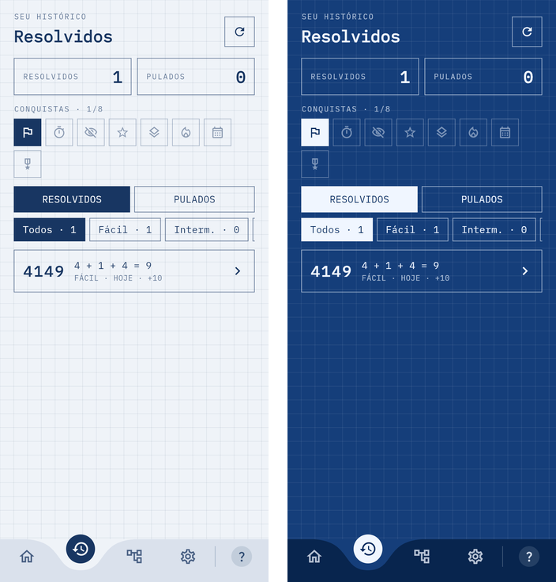
 |
| Cada usuário com a sua conta e pontuação, com login pela Google | O documento `users/{uid}` guarda pontos, resolvidos por nível, conquistas, sequência de dias, recordes e avatar. As regras do Firestore só deixam cada jogador ler e escrever os próprios dados. | [firestore_repository.dart](lib/data/firestore_repository.dart), [firestore.rules](firestore.rules) | 

ver tela
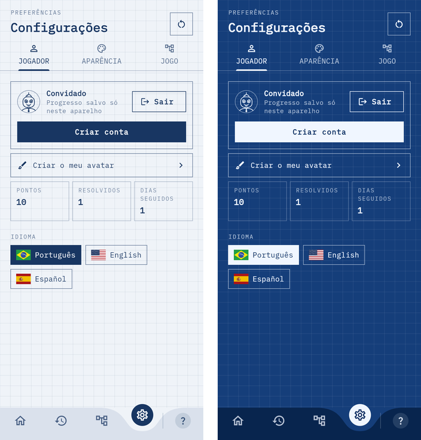
 |
| Guardar os números resolvidos e sortear só os não resolvidos | Cada acerto grava `users/{uid}/solved/{nível_número}`. Antes de sortear, o app lê os resolvidos do nível e os tira do sorteio. Quando todos acabam, ele avisa. | [firestore_repository.dart](lib/data/firestore_repository.dart), [catalog_provider.dart](lib/features/game/application/catalog_provider.dart) | 

ver tela

 |
| Pular um número difícil | O botão **PULAR** (ou `Esc`) pergunta se o jogador quer ver uma solução. Se não quiser, nada é revelado, e o número volta ao sorteio em outro dia. | [skip_dialog.dart](lib/features/game/presentation/skip_dialog.dart), [game_page.dart](lib/features/game/presentation/game_page.dart) | 

ver tela
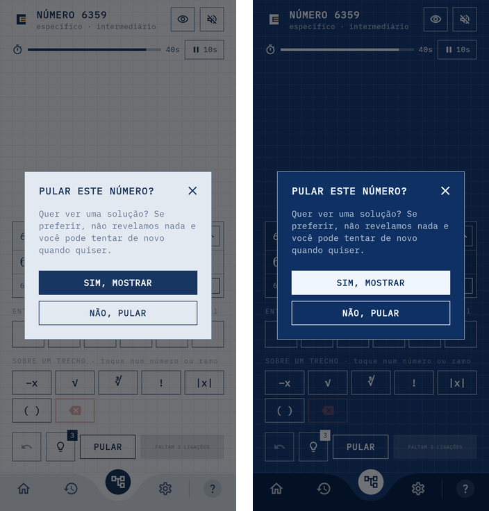
 |
| Botão de ajuda na barra inferior, com `showDialog` ou algo semelhante | O último item da barra abre a Ajuda num diálogo (`showGeneralDialog`), com as guias Jogar, Operadores e Pontos. O relógio pausa enquanto ela está aberta. | [app_shell.dart](lib/features/shell/app_shell.dart), [help_page.dart](lib/features/help/help_page.dart) | 

ver tela
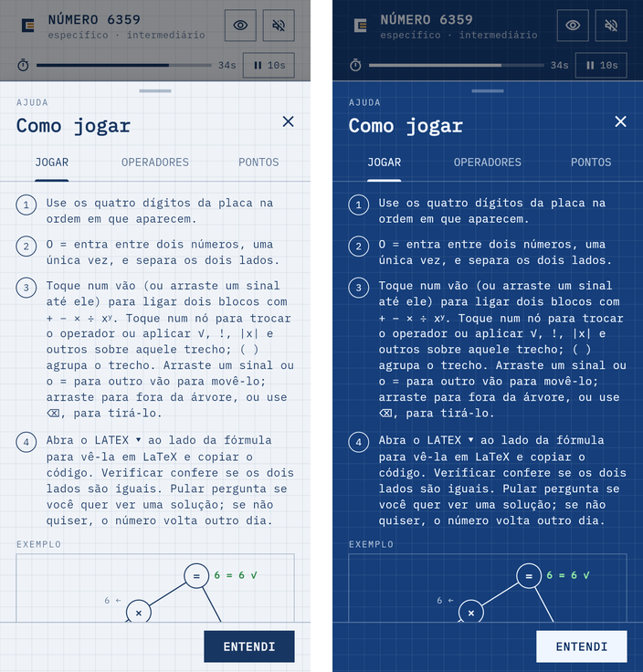
 |
| Adaptação a celular, computador e web de vários tamanhos | A partir de 1024 px, a árvore fica à esquerda, e a fórmula e a paleta à direita. No celular, tudo empilha. As outras telas limitam a largura do conteúdo e reorganizam colunas. | [game_page.dart](lib/features/game/presentation/game_page.dart), [bp_widgets.dart](lib/core/widgets/bp_widgets.dart) | 

ver tela
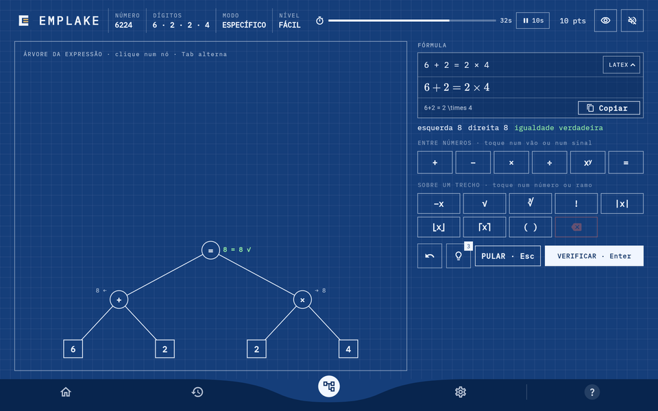
 |

## O que vai além do pedido

  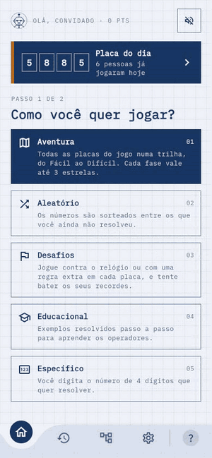

- **Seis modos de jogo.** Aleatório e Específico, como no original, e mais quatro:
  - **Aventura:** as 150 placas numa trilha, do Fácil ao Difícil, com até 3 estrelas por fase. As 10
    primeiras fases não têm relógio, para quem está começando aprender os operadores sem pressão.
  - **Desafios:** *Contra o relógio*, com 3 minutos para a partida inteira, e *Com restrição*, em que
    cada placa traz uma regra extra (sem um operador, com um operador obrigatório ou com o `=` fixo) e o
    jogador tem 3 vidas.
  - **Placa do dia:** a mesma placa para todo mundo, sem repetir até o ciclo acabar. Depois de jogar,
    aparece quanto tempo levou, a comparação com os outros jogadores e um resultado para compartilhar
    que não revela a solução.
  - **Educacional:** 12 lições, uma por operador, com uma placa resolvida passo a passo e outra para
    praticar.
- **Catálogo verificado.** Todas as placas têm solução conferida pelo próprio motor do jogo, com a
  dificuldade calculada por um solver. No modo Específico, o solver diz em que níveis o número digitado
  tem solução.
- **Dicas em escada.** A 1ª dica mostra onde vai o `=`, a 2ª mostra uma ligação e a 3ª revela a solução.
  Cada dica reduz os pontos.
- **Valores em tempo real** em cada ramo da árvore. Quem joga sem eles ganha 25% a mais.
- **Conquistas e dias seguidos.** São 8 conquistas, e o ícone de fogo da tela inicial conta os dias
  seguidos em que o jogador resolveu alguma placa.
- **Modo convidado.** Dá para jogar sem criar conta e criar a conta depois sem perder o progresso.
- **Avatar.** Cada jogador monta o seu robô.
- **Tutorial da primeira partida**, um passo a passo que aponta onde tocar e pode ser refeito nas
  configurações.
- **Acessibilidade:** rótulos para leitor de tela, opção de reduzir animações e controle completo pelo
  teclado no desktop.

Mais telas

| Aventura | Desafios | Com restrição |
|---|---|---|
| 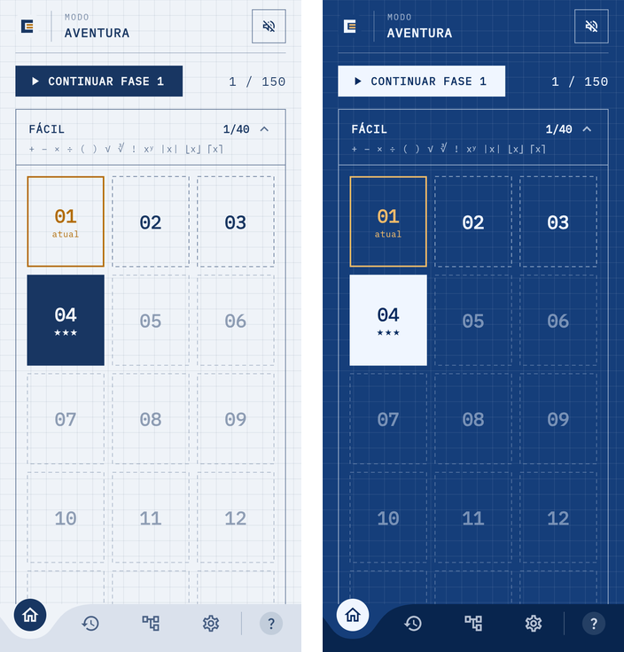 | 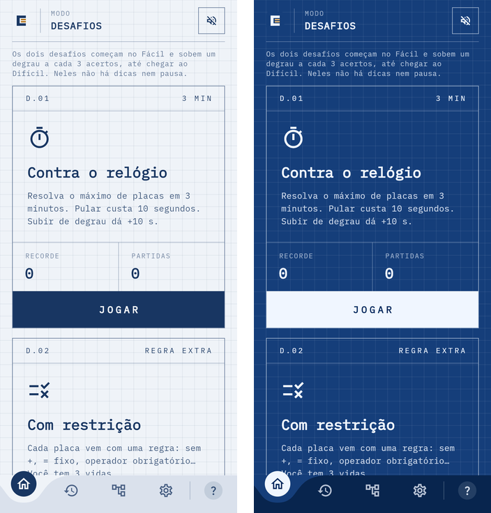 | 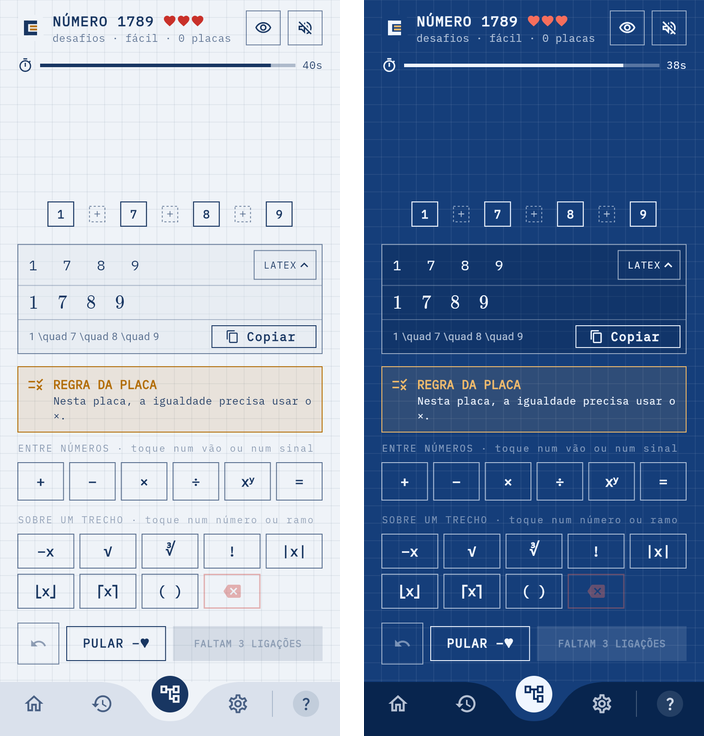 |

| Educacional | Tutorial | Avatar |
|---|---|---|
| 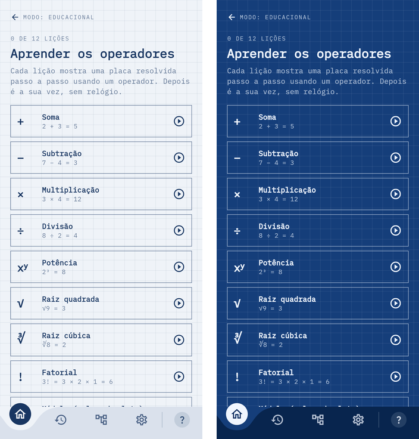 | 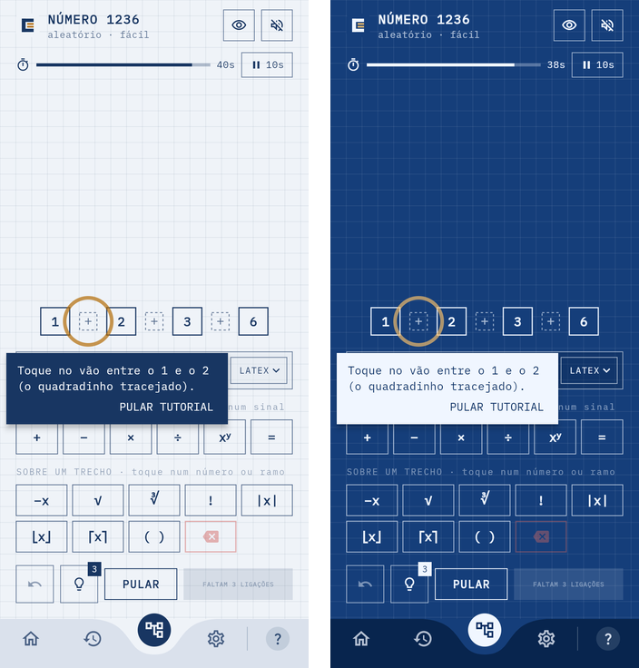 | 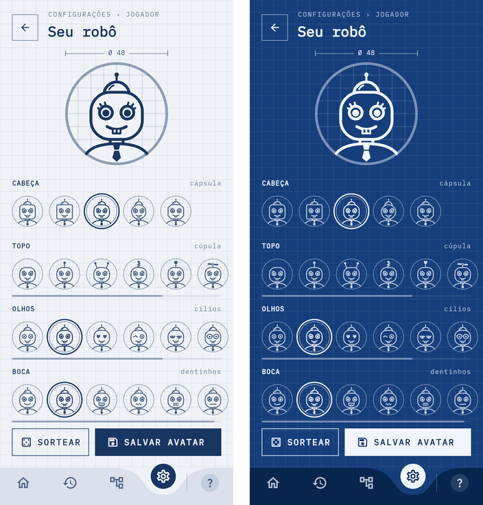 |

| Resultado | Início no desktop |
|---|---|
| 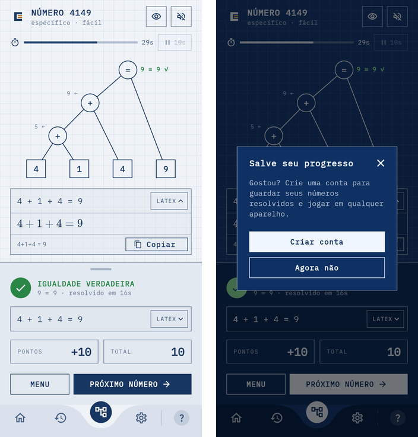 | 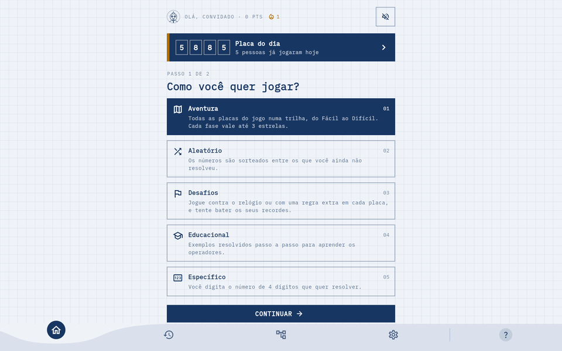 |

## Decisões de design

### A expressão como árvore

No original, os operadores são arrastados para uma linha. Aqui, cada ligação entre dois blocos cria um
nó acima deles, então a ordem das ligações já define o agrupamento, e o jogador vê o valor de cada ramo
enquanto monta. Isso torna a tela principal diferente das outras e evita o erro mais comum, que é
esquecer um parêntese. Seguindo a dica do enunciado, o `=` pode ser o primeiro sinal colocado.

### O login não é a primeira tela

Pedir conta antes da primeira partida faz muita gente desistir. Por isso, tocar na capa já entra como
convidado, com um login anônimo do Firebase que guarda o progresso. O app sugere criar a conta em
momentos de valor, como a primeira conquista, e a conta criada depois mantém tudo o que o convidado fez.

A tela de login continua completa, com e-mail e senha, Google, os nomes da equipe e a escolha de idioma
com bandeiras. Ela abre pelo link **"Já tem conta? Entrar"** na capa e depois do botão **Sair**, na guia
Jogador das configurações. Quem ainda não entrou também chega a ela direto por
<https://emplake.web.app/login>.

### LaTeX no botão da caixa da fórmula

No celular, a árvore, a fórmula e a paleta já ocupam a tela inteira. Com o LaTeX sempre visível, a
paleta ficaria abaixo da dobra. Por isso, o LaTeX fica dentro da caixa da fórmula, logo abaixo da
expressão em texto, e abre com um toque no botão **LATEX**. O app lembra a escolha, então quem deixa
aberto continua vendo o LaTeX em todas as partidas. A folha de resultado também tem o botão, para ver o
LaTeX da igualdade final.

### Um catálogo em vez de números aleatórios

Muitos números de quatro dígitos não têm solução no Difícil. Sortear qualquer número faria o jogador
perder tempo com placas impossíveis. O jogo sorteia de um catálogo de 150 placas, todas com solução
verificada, distribuídas por nível e dificuldade. O catálogo inteiro está documentado, placa por placa,
em [docs/catalogo/](docs/catalogo/README.md).

### Referências do Duolingo

A trilha da Aventura, a escada do Contra o relógio, as vidas do Com restrição, os dias seguidos e o
resultado compartilhável da placa do dia vêm de padrões que o Duolingo usa para fazer as pessoas
voltarem. Os motivos de cada regra estão em [docs/modos.md](docs/modos.md).

### A Ajuda como diálogo

A Ajuda abre por cima da partida, sem tirar o jogador do jogo, e o relógio pausa enquanto ela está
aberta. A guia aberta depende da tela: no jogo, ela começa em Jogar, e no histórico, em Pontos.

### Som desligado no começo

O enunciado aponta o som automático do original como um erro de usabilidade. Aqui, os efeitos e a
música começam desligados e se ligam juntos no botão do topo.

### Fontes que combinam com o tema

O visual imita uma planta técnica, com grade, traços finos e letras de desenho técnico. As cinco fontes
oferecidas (IBM Plex Mono, JetBrains Mono, Space Mono, IBM Plex Sans e Space Grotesk) mantêm esse estilo.
Uma fonte como Garamond quebraria o visual.

### Flutter 3.50 e material_ui

O app roda no Flutter 3.50 (Dart 3.14). A migração para os pacotes `material_ui` e `cupertino_ui`
(`dart fix --apply --code=migrate_design_widgets`) foi feita na branch `migra-flutter-3-50`, mas ficou
fora da `main`: o `firebase_ui_auth`, exigido para o login, ainda usa `package:flutter/material.dart`.
No 3.50, essa biblioteca é uma cópia separada do Material, então os widgets do pacote não encontram o
tema nem as traduções do app, e o formulário de login quebra. O `curved_navigation_bar`, o
`flutter_math_fork`, o `loading_animation_widget` e o `country_flags` também ainda usam a biblioteca
antiga. Como ela só está descontinuada, sem data de remoção, a `main` segue com ela até esses pacotes
migrarem.

## Mais documentação

| Documento | O que tem |
|---|---|
| [docs/desenvolvimento.md](docs/desenvolvimento.md) | Estrutura do código, configuração do Firebase, como rodar e publicar, textos e idiomas. |
| [docs/modos.md](docs/modos.md) | Regras e motivos da Aventura e dos Desafios. |
| [docs/catalogo/](docs/catalogo/README.md) | As 150 placas, cada uma com a solução, a dificuldade e as variantes do desafio Com restrição. |

## Créditos

O Emplake foi concebido pelo Prof. Walter A. Carnielli, que detém os direitos do jogo. Os efeitos
sonoros e a música foram sintetizados para este projeto.
